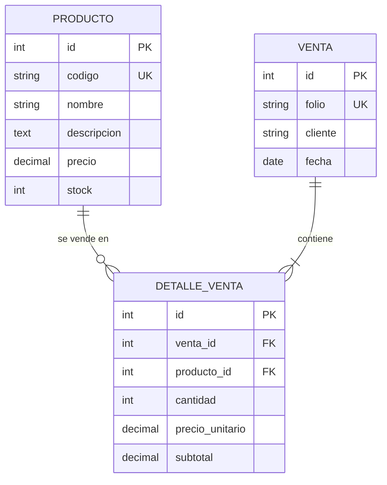

# Control de Ventas - Evaluación Sumativa 2 (Programación Backend)

Aplicación web para digitalizar las ventas de productos de una pequeña tienda (**Caso 2: Aplicación de Control de Venta**). Permite administrar productos, registrar ventas con múltiples líneas de detalle y controlar el stock automáticamente.

**Autor:** <Tu Nombre> · INACAP · Programación Backend

| Recurso | Enlace |
|---|---|
| Aplicación en producción | https://sales-control-app-e-va3.vercel.app/ |
| Panel de administración | https://sales-control-app-e-va3.vercel.app/admin/ |
| Repositorio (público) | https://github.com/<tu-usuario>/sales-control-app |

---

## 1. Credenciales de prueba

| Campo | Valor |
|---|---|
| Usuario | `admin` |
| Contraseña | `<TU_CLAVE_DE_PRUEBA>` |

> Cuenta creada solo para la evaluación. La base de datos de producción ya contiene datos de demostración (comando `seed_data`).

---

## 2. Tecnologías

| Capa | Tecnología |
|---|---|
| Lenguaje / Framework | Python 3.12 · Django 5.1 |
| Base de datos (producción) | PostgreSQL en Supabase (Session pooler) |
| Configuración | `python-decouple` (variables de entorno) · `dj-database-url` |
| Archivos estáticos | WhiteNoise · `collectstatic` |
| Interfaz | Plantillas Django + Bootstrap 5.3 (responsivo) |
| Despliegue | Vercel (WSGI) |
| Control de versiones | Git + GitHub (repositorio público) |

SQLite **no** se usa en producción: tanto el entorno local como el desplegado se conectan a PostgreSQL mediante `DATABASE_URL`.

---

## 3. Arquitectura MVT (Model - View - Template)

Django implementa el patrón **MVT**, equivalente a MVC con otro nombre: el framework hace de controlador.

```
Navegador ──► core/urls.py ──► ventas/urls.py ──► ventas/views.py ──► ventas/models.py ──► PostgreSQL
                                                        │
                                                        └──► templates/*.html (respuesta HTML)
```

| Componente | Archivo(s) | Responsabilidad |
|---|---|---|
| **Model** | `ventas/models.py` | Entidades, relaciones, restricciones de BD y lógica de stock |
| **View** | `ventas/views.py` | Recibe la petición, valida con formularios, aplica reglas y elige la plantilla |
| **Template** | `templates/base.html`, `templates/ventas/*.html` | Presentación HTML con Bootstrap |
| **URLconf** | `core/urls.py`, `ventas/urls.py` | Enrutamiento de URLs hacia vistas |
| **Forms** | `ventas/forms.py` | Validación de datos de entrada (`clean()`) |
| **Admin** | `ventas/admin.py` | Panel de administración personalizado |

### Estructura del proyecto

```
sales-control-app/
├── core/                        # Configuración del proyecto
│   ├── settings.py              # BD dinámica, WhiteNoise, LOGGING
│   ├── urls.py
│   └── wsgi.py                  # expone `app = application` para Vercel
├── ventas/                      # Aplicación principal
│   ├── management/commands/
│   │   └── seed_data.py         # Carga de datos de prueba
│   ├── admin.py
│   ├── forms.py
│   ├── models.py
│   ├── urls.py
│   └── views.py
├── templates/
│   ├── base.html
│   ├── admin/ventas/...         # Reporte por fechas del admin
│   └── ventas/                  # Plantillas de productos y ventas
├── static/
├── build_files.sh               # pip install + collectstatic
├── vercel.json
├── requirements.txt
├── .env.example
└── manage.py
```

---

## 4. Modelo de datos y justificación



**¿Por qué tres tablas?** Una venta puede incluir muchos productos y un producto aparece en muchas ventas: es una relación **muchos a muchos**. `DetalleVenta` es la tabla intermedia que además guarda datos propios de la relación (cantidad, precio y subtotal). Así se evita repetir columnas y se mantiene la tabla normalizada.

| Decisión | Justificación |
|---|---|
| `Producto.codigo` único | Identifica el producto sin ambigüedad (SKU) |
| `DetalleVenta.precio_unitario` guardado | Conserva el precio al momento de la venta, aunque el producto cambie de precio después |
| `DetalleVenta.subtotal` guardado | Evita recalcular y asegura el historial |
| `Venta.folio` autogenerado (`V-000001`) | Número correlativo único y editable solo por el sistema |
| `on_delete=PROTECT` en `producto` | No se puede borrar un producto con ventas registradas (integridad histórica) |
| `on_delete=CASCADE` en `venta` | Al borrar una venta se eliminan sus detalles |
| `CheckConstraint` precio y stock `>= 0` | La base de datos también rechaza valores negativos, no solo el formulario |
| Categoría de producto | Se registra en la descripción del producto (el caso no exige una tabla aparte) |

### Reglas de negocio implementadas

- Al guardar un detalle de venta, el **stock del producto baja automáticamente**.
- Al editar un detalle (cambiar cantidad o producto), el stock anterior se **restituye** y se descuenta el nuevo.
- Al eliminar un detalle o una venta completa, el stock se **restituye** (señal `pre_delete`).
- Si el precio unitario se deja en `0`, se usa el **precio actual del producto**.
- Stock crítico: **5 unidades o menos** (aviso en pantalla y badge de color).
- Las operaciones se ejecutan dentro de `transaction.atomic()` para evitar datos a medias.

---

## 5. Validaciones (en `ventas/forms.py`, método `clean()`)

| Formulario | Validación |
|---|---|
| `ProductoForm` | Precio no negativo · stock no negativo · código normalizado a mayúsculas y único |
| `VentaForm` | Cliente con mínimo 2 caracteres · fecha no futura |
| `DetalleVentaForm` | Cantidad mayor que 0 · precio no negativo · **cantidad no puede superar el stock disponible** |
| `BaseDetalleVentaFormSet` | La venta debe tener al menos un producto · suma de cantidades por producto no puede superar el stock (si el mismo producto aparece en varias líneas) |

---

## 6. Funcionalidades

### Aplicación web (CRUD completo)

| Módulo | URL | Acción |
|---|---|---|
| Productos | `/productos/` | Listar, buscar por código/nombre, paginar (8 por página) |
| | `/productos/nuevo/` | Crear |
| | `/productos/<id>/` | Detalle + últimas ventas del producto |
| | `/productos/<id>/editar/` | Editar |
| | `/productos/<id>/eliminar/` | Confirmar y eliminar |
| Ventas | `/ventas/` | Listar con total, buscar por folio/cliente, paginar |
| | `/ventas/nueva/` | Crear venta con líneas dinámicas |
| | `/ventas/<id>/` | Detalle con subtotales y total |
| | `/ventas/<id>/editar/` | Editar venta y líneas |
| | `/ventas/<id>/eliminar/` | Confirmar y eliminar (restituye stock) |

**Mensajes (`django.contrib.messages`):** éxito (verde), advertencia de stock crítico (amarillo) y error (rojo).

### Panel de administración (`/admin/`)

- **Branding:** `site_header`, `site_title` e `index_title` personalizados.
- `DetalleVenta` como **`TabularInline`** dentro de la venta.
- **Monto total** de cada venta en el listado y en el detalle.
- Filtros por fecha: `date_hierarchy` y `list_filter`.
- Búsqueda por cliente y folio.
- **Reporte de ventas por rango de fechas:** botón "Reporte por fechas" en el listado de ventas.

### Auditoría

`LOGGING` envía a la consola los eventos de la aplicación (ventas creadas, stock actualizado/restituido, productos creados/editados/eliminados). En Vercel se revisan en la pestaña **Logs** del proyecto.

---

## 7. Instalación local

```powershell
git clone https://github.com/<tu-usuario>/sales-control-app.git
cd sales-control-app
python -m venv venv
.\venv\Scripts\Activate.ps1
pip install -r requirements.txt
Copy-Item .env.example .env       # luego completa los valores reales
python manage.py migrate
python manage.py seed_data
python manage.py createsuperuser
python manage.py runserver
```

### Variables de entorno (`.env`)

| Variable | Descripción |
|---|---|
| `SECRET_KEY` | Clave secreta de Django |
| `DEBUG` | `True` en local, `False` en producción |
| `ALLOWED_HOSTS` | Hosts permitidos, separados por coma (`.vercel.app` en producción) |
| `DATABASE_URL` | URI de PostgreSQL (Supabase, Session pooler) |

El archivo `.env` real **no se sube** al repositorio (`.gitignore`); solo `.env.example`.

### Datos de prueba

```powershell
python manage.py seed_data
```
Crea 12 productos (incluye algunos con stock crítico y uno agotado) y 4 ventas de ejemplo. Es seguro ejecutarlo más de una vez: los productos se crean con `get_or_create` y las ventas solo se cargan si no existe ninguna.

---

## 8. Despliegue (Vercel)

- `vercel.json`: comando de build y configuración de la función WSGI (`core/wsgi.py`).
- `build_files.sh`: `pip install -r requirements.txt` y `collectstatic --noinput`.
- `core/wsgi.py` expone `app = application`.
- Variables configuradas en Vercel: `SECRET_KEY`, `DEBUG=False`, `ALLOWED_HOSTS`, `DATABASE_URL`.
- Cada `push` a `main` dispara un nuevo despliegue automático.

---

## 9. Guion de demostración (presentación oral, ~7 minutos)

### Paso 1: Introducción (30 s)
> "Desarrollé una aplicación Django para controlar las ventas de una tienda pequeña. Está desplegada en Vercel, usa PostgreSQL en Supabase y el código está en un repositorio público."

Mostrar el repositorio en GitHub y la URL de producción.

### Paso 2: Arquitectura y modelo (1 min 30 s)
- Explicar MVT con el diagrama de la sección 3.
- Mostrar el diagrama de la sección 4 y justificar `DetalleVenta` como tabla intermedia.

### Paso 3: CRUD de productos (1 min 30 s)
1. Ir a `/productos/` → mostrar badges de stock, buscador y paginación.
2. **Crear** un producto: código `DEMO-001`, precio `1500`, stock `10` → mensaje verde.
3. **Editar** el producto y bajar el stock a `3` → mensaje verde + advertencia amarilla de stock crítico.
4. **Validación:** intentar guardar con precio `-100` → error en rojo bajo el campo.
5. **Eliminar** `DEMO-001` desde la pantalla de confirmación.

### Paso 4: Ventas (2 min)
1. Ir a `/ventas/nueva/` → cliente "Demo Docente", agregar 2 líneas con `+ Agregar línea`.
2. **Validación de stock:** pedir una cantidad mayor al stock disponible → error "Stock insuficiente".
3. Corregir y guardar → mensaje de éxito, folio generado y total calculado.
4. Volver a `/productos/` y mostrar que **el stock bajó**.
5. Eliminar la venta de demostración → **el stock se restituye**.

### Paso 5: Panel de administración (1 min 30 s)
1. Entrar a `/admin/` con las credenciales de la sección 1 → mostrar el branding.
2. Abrir **Ventas**: columna "Monto total", filtro por fecha, `date_hierarchy` y buscador.
3. Abrir una venta: mostrar el **inline** de detalles.
4. Clic en **Reporte por fechas**, elegir un rango y mostrar el total.

### Paso 6: Cierre (30 s)
> "Cumple con base de datos PostgreSQL en producción, validaciones en formularios, CRUD completo, mensajes, paginación, panel de administración personalizado, auditoría con logging y despliegue público."

---

## 10. Preguntas frecuentes de defensa

**¿Por qué PostgreSQL y no SQLite?**
SQLite guarda un archivo local y Vercel tiene un sistema de archivos efímero: los datos se perderían. PostgreSQL en Supabase persiste los datos y permite conexiones concurrentes.

**¿Cómo se actualiza el stock?**
En `DetalleVenta.save()`: restituye la cantidad anterior (si se edita), calcula el subtotal y descuenta el nuevo stock con `F()` dentro de una transacción. Al eliminar, una señal `pre_delete` lo restituye.

**¿Por qué se usa `F("stock")` en vez de leer y escribir el valor?**
`F()` hace la operación en la base de datos (`stock = stock - N`), evitando condiciones de carrera entre dos ventas simultáneas.

**¿Por qué `PROTECT` en el producto?**
Para no perder el historial: un producto con ventas no puede borrarse. La vista captura `ProtectedError` y muestra un mensaje claro.

**¿Por qué se guarda `precio_unitario` si ya existe `Producto.precio`?**
El precio del producto puede cambiar; la venta debe conservar el precio con que se realizó.

**¿Para qué sirve WhiteNoise?**
Sirve archivos estáticos comprimidos y con versión desde la propia app Django. En Vercel, además, los estáticos recolectados se entregan por CDN.

**¿Cómo se protegen las credenciales?**
Con variables de entorno (`python-decouple`); `.env` está en `.gitignore` y solo se publica `.env.example`.

**¿Qué protecciones de seguridad incluye?**
Token CSRF en todos los formularios `POST`, ORM de Django (previene inyección SQL), escape automático de plantillas (previene XSS) y `DEBUG=False` en producción.

**¿Qué es un `formset`?**
Un conjunto de formularios del mismo tipo. Se usa para registrar varias líneas de detalle en una sola venta.

**¿Qué mejoras se podrían agregar?**
Autenticación para el sitio público, categorías como tabla propia, reportes exportables a PDF/Excel, pruebas automatizadas y tabla de movimientos de inventario.